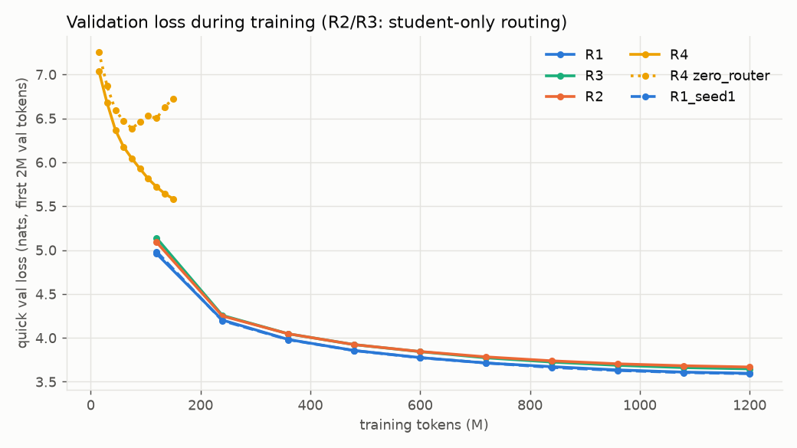
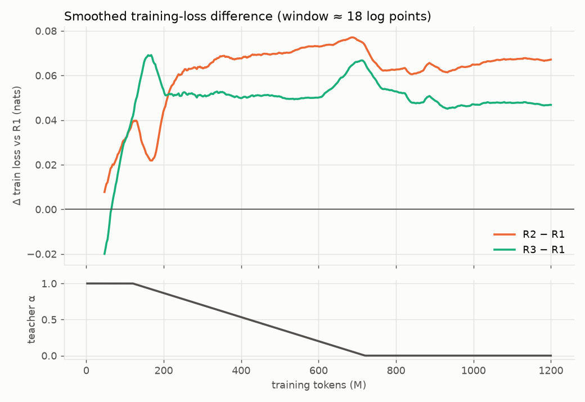
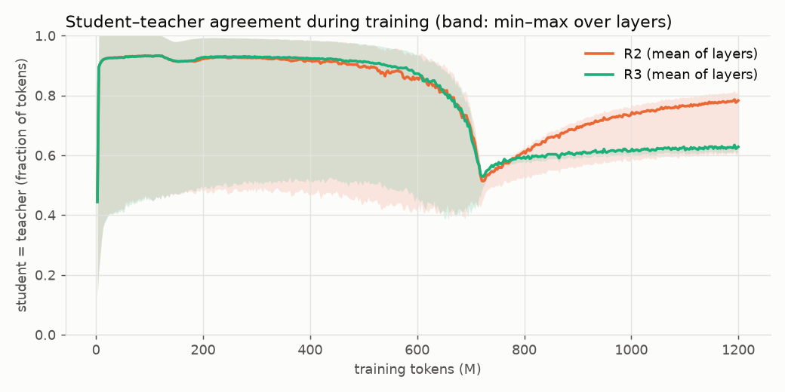

# Subject-aware MoE routing: report

_Generated 2026-11-22 04:30:03 from `/home/architta/moe_lookahead`._

## Verdict

**Seeing the future helped** (R3 < R2 − δ). R1 = 3.5069, R2 = 3.5773, R3 = 3.5564 nats; δ = 0.0100. R2 − R1 = +0.0704, R3 − R1 = +0.0495, R3 − R2 = -0.0209. Note: R3 does not beat the R1 baseline by more than δ, so the future teacher only helped relative to the past teacher.

_Noise estimate |R1 − R1_seed1| = 0.0036 nats → δ = max(0.01, 2 × noise) = 0.0100._

Decision rule: R3 < R2 − δ → the future helped; |R3 − R2| ≤ δ and both < R1 − δ → subject supervision helped and the future did not matter; neither beats R1 by more than δ → no help at this scale; anything else is described as is. Values are means over seeds where two seeds exist. All R2/R3 numbers use **student-only routing** (honest, causal).

## Main results (full validation stream)

| run | val loss | ppl | Δ vs R1 | first 64 tokens of doc | rest | step |
|---|---:|---:|---:|---:|---:|---:|
| R1 | 3.5087 | 33.41 | 0.0000 | 4.1726 | 3.4642 | 4577 |
| R2 | 3.5773 | 35.78 | 0.0686 | 4.3058 | 3.5285 | 4577 |
| R3 | 3.5564 | 35.04 | 0.0477 | 4.2646 | 3.5089 | 4577 |
| R1_seed1 | 3.5051 | 33.28 | -0.0036 | 4.1710 | 3.4604 | 4577 |

- R1: two seeds 3.5087 / 3.5051 → mean 3.5069

'First 64 tokens of doc' = target tokens at most 64 positions after the latest preceding EOT (where subject information is scarcest). R3's teacher, for a token at offset k within its 64-token block, has seen 63 − k future tokens; R2's teacher only sees the past.

## Loss by source (source of the target token)

| run | CC | C4 | Github | Book | ArXiv | Wiki | StackEx |
|---|---:|---:|---:|---:|---:|---:|---:|
| R1 (normal) | 3.7967 | 3.9355 | 1.4597 | 3.8201 | 2.2618 | 2.9626 | 2.4036 |
| R3 (student) | 3.8570 | 3.9892 | 1.4480 | 3.8434 | 2.2237 | 3.0500 | 2.4124 |
| R2 (student) | 3.8772 | 4.0114 | 1.4636 | 3.8691 | 2.2345 | 3.0819 | 2.4395 |
| R4 (leaky) | 5.8061 | 5.8056 | 3.9120 | 5.2485 | 4.4557 | 5.2385 | 4.5067 |
| R1_seed1 (normal) | 3.7918 | 3.9329 | 1.4555 | 3.8161 | 2.2592 | 2.9672 | 2.4002 |
| _tokens_ | 4,879,113 | 2,557,597 | 624,611 | 118,730 | 435,786 | 435,613 | 427,718 |

## Leak check (R2/R3): teacher routing vs student routing

A large gap (teacher ≪ student) means the routing decision carries information the causal student cannot reproduce; for R3 that includes the future.

| run | student loss | teacher (α=1) loss | gap (student − teacher) |
|---|---:|---:|---:|
| R2 | 3.5773 | 3.5830 | -0.0057 |
| R3 | 3.5564 | 3.5677 | -0.0113 |

## Routing diagnostics (full validation stream, headline routing)

Reference: I(cluster; source) = **0.415 bits** (token level, cluster of the token's own block). Max for 7 sources: 2.807 bits.

| run | I(expert; source) mean | per layer | max expert load per layer | load entropy (bits, max 3) | agreement per layer |
|---|---:|---|---|---|---|
| R1 | 0.069 | 0.18, 0.05, 0.00, 0.04, 0.06, 0.09, 0.05, 0.08 | 0.14, 0.15, 0.15, 0.14, 0.20, 0.17, 0.21, 0.18 | 3.00, 2.99, 3.00, 2.99, 2.92, 2.91, 2.88, 2.94 | — |
| R3 | 0.508 | 0.50, 0.50, 0.50, 0.50, 0.51, 0.51, 0.51, 0.52 | 0.15, 0.15, 0.16, 0.16, 0.16, 0.16, 0.16, 0.16 | 2.96, 2.97, 2.96, 2.96, 2.96, 2.96, 2.96, 2.96 | 0.61, 0.62, 0.62, 0.63, 0.63, 0.63, 0.63, 0.62 |
| R2 | 0.445 | 0.50, 0.44, 0.43, 0.44, 0.44, 0.44, 0.44, 0.44 | 0.16, 0.15, 0.15, 0.15, 0.15, 0.15, 0.15, 0.16 | 2.96, 2.98, 2.97, 2.97, 2.97, 2.97, 2.97, 2.97 | 0.60, 0.78, 0.81, 0.81, 0.81, 0.81, 0.81, 0.81 |
| R4 | 0.350 | 0.17, 0.41, 0.19, 0.34, 0.28, 0.26, 0.58, 0.56 | 0.27, 0.26, 0.33, 0.33, 0.24, 0.26, 0.26, 0.29 | 2.47, 2.73, 2.71, 2.71, 2.74, 2.80, 2.74, 2.72 | — |
| R1_seed1 | 0.074 | 0.19, 0.05, 0.00, 0.06, 0.06, 0.07, 0.08, 0.07 | 0.15, 0.13, 0.14, 0.13, 0.17, 0.18, 0.22, 0.19 | 2.99, 3.00, 2.99, 3.00, 2.90, 2.92, 2.80, 2.96 | — |

## R4 demo: the naive leaky router

R4's router sees the mean hidden state of positions t+2 … t+51 (the future). Teacher-forced loss looks good; at generation time those positions don't exist (zero_router).

| model | val loss |
|---|---:|
| R4 leaky routing (teacher-forced view) | 5.5274 |
| R4 zero_router (generation-time view) | 6.6455 |
| R1 at the same token count (R1_r4ref, step 572) | 4.5321 |

_R1_r4ref is a rough reference only: R1's learning rate had not finished decaying at that point, while R4 ran its own full schedule._

## Plots

_The α schedule is drawn in its own panel under the loss difference (shared x axis) instead of on a second y axis._

## Setup

- model: base {'n_layer': 8, 'd_model': 512, 'n_head': 8, 'd_ff': 1024, 'n_exp': 8, 'vocab': 50304, 'ctx': 1024, 'lb_coef': 0.01, 'distill_coef': 0.1, 'r4_lo': 2, 'r4_hi': 51}
- parameters: total 110.2M, active per token 51.5M, embedding 26.3M
- tokens per run: 1199.8M (4577 steps × 262,144); R4: 149.9M (572 steps) — **capped by available training tokens**
- throughput (bench, min of R1/R3): 251,958 tokens/s on NVIDIA H100 80GB HBM3; projected 1.81B tokens per 2 h
- optimizer: AdamW β=[0.9, 0.95] eps=1e-08 wd=0.1 (≥2-D params), peak lr 0.001 → 0.0001, linear warmup 2% of steps, cosine to min_lr, clip 1.0; micro-batch 32 × 1024 × 8 accumulation; bf16 autocast + TF32
- routing: LB coef 0.01 (R1/R4), distillation coef 0.1 (R2/R3); α: 1 for step<0.1S; linear 1->0 over [0.1S,0.6S); 0 after
- torch 2.14.1+cu126 / CUDA 12.6; data fingerprint 0a5972d138c111d6-3b179e6d18d73f73
- data: 1,200M train tokens (1,171,874 sequences), 9.5M validation tokens

### Clusters (teacher labels)

- featurizer: **idf_bag_rp256** — fallback: MiniLM projected 43.2 min > 30 min to assign all blocks
- train cluster sizes (%): 14.1, 10.6, 13.6, 9.6, 11.5, 14.0, 12.7, 13.9; balance converged: True
- I(cluster; block majority source): 0.435 bits (train). Full table and sample texts: [clusters.md](clusters.md)

### GPUs and wall-clock

| run | GPU(s) / node(s) | job segments | training minutes |
|---|---|---:|---:|
| R1 | NVIDIA H100 80GB HBM3 @ node2906 | 1 | 63.6 |
| R3 | NVIDIA H100 80GB HBM3 @ node2906 | 1 | 61.4 |
| R2 | NVIDIA H100 80GB HBM3 @ node2906 | 1 | 62.1 |
| R4 | NVIDIA H100 80GB HBM3 @ node2906 | 1 | 10.3 |
| R1_seed1 | NVIDIA H100 80GB HBM3 @ node2906 | 1 | 64.1 |

Per job (from `sacct`; wait = start − eligible, i.e. queue time after dependencies were met):

| job | state | node | submitted | wait | run |
|---|---|---|---|---:|---:|
| mla_prep (29956697) | COMPLETED | node1611 | 2026-11-21 10:58:49 | 0h18m | 0h02m |
| mla_clusters (29956698) | COMPLETED | node2906 | 2026-11-21 10:58:49 | 10h27m | 0h01m |
| mla_bench (29956699) | COMPLETED | node2906 | 2026-11-21 10:58:50 | 1h08m | 0h01m |
| mla_train_R1 (29956700) | COMPLETED | node2906 | 2026-11-21 10:58:51 | 0h07m | 1h04m |
| mla_train_R3 (29956701) | COMPLETED | node2906 | 2026-11-21 10:58:53 | 3h13m | 1h02m |
| mla_train_R2 (29956702) | COMPLETED | node2906 | 2026-11-21 10:58:53 | 4h08m | 1h02m |
| mla_train_R4 (29956704) | COMPLETED | node2906 | 2026-11-21 10:58:53 | 4h16m | 0h10m |
| mla_train_R1_seed1 (29956705) | COMPLETED | node2906 | 2026-11-21 10:58:53 | 4h26m | 1h04m |
| mla_eval (29956706) | RUNNING | node2906 | 2026-11-21 10:58:55 | 0h00m | — |

First submission → last finished job: **17h29m** (the running eval job itself is not finished yet when this is written).

## Missing or failed runs

None.

